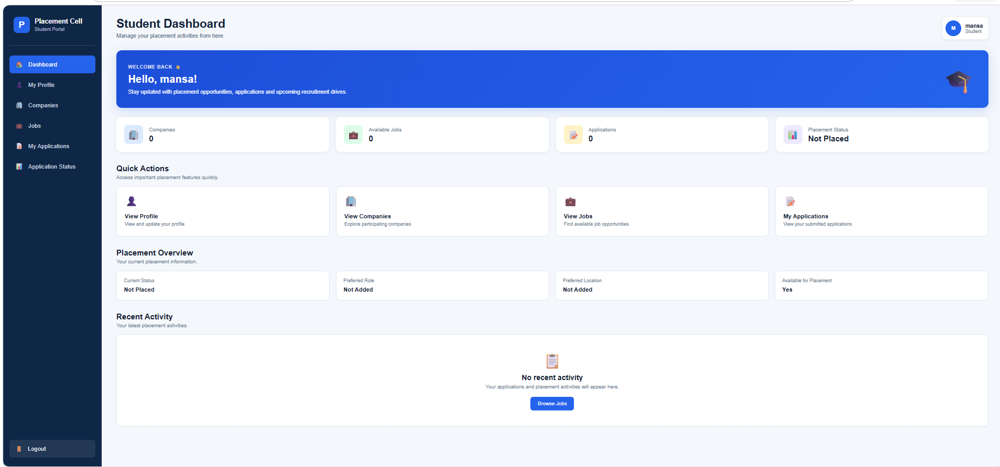
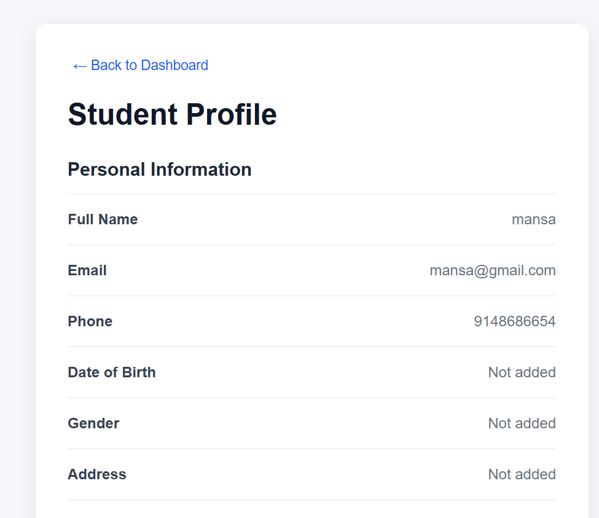
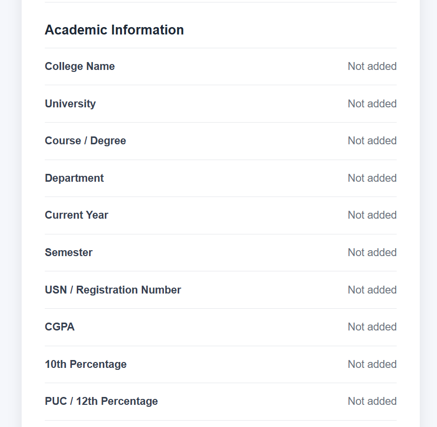
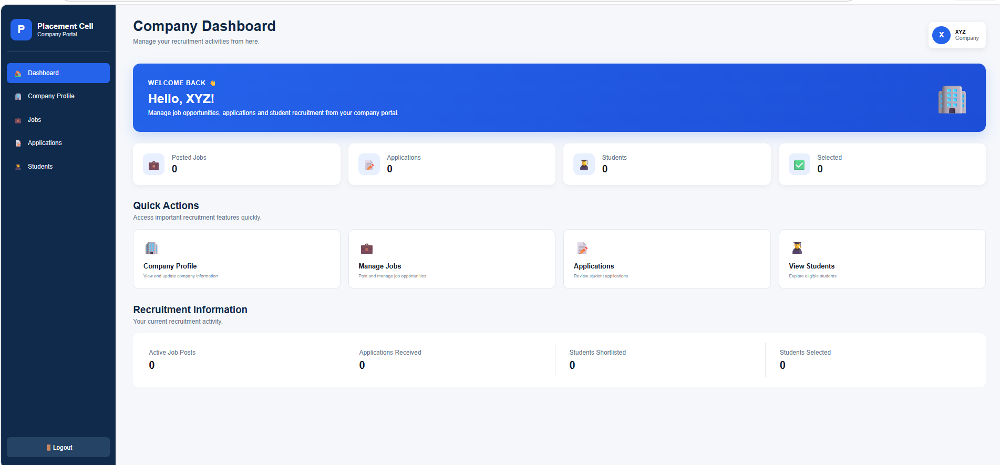
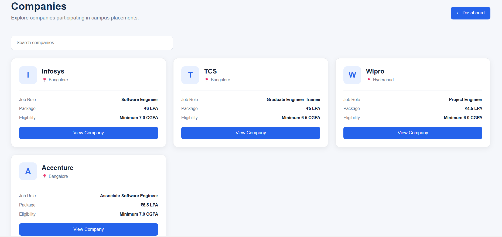
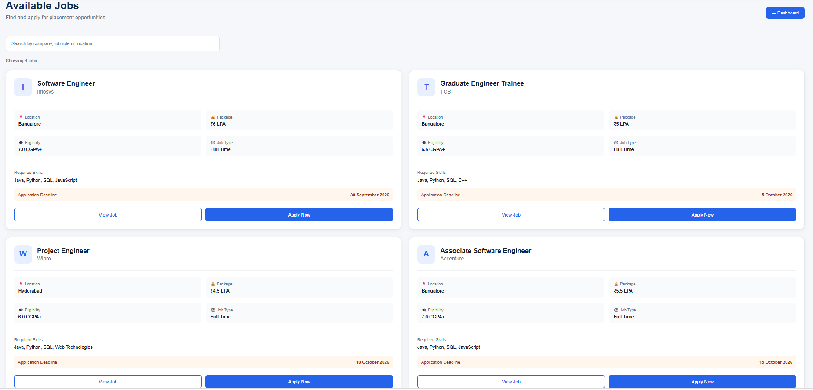
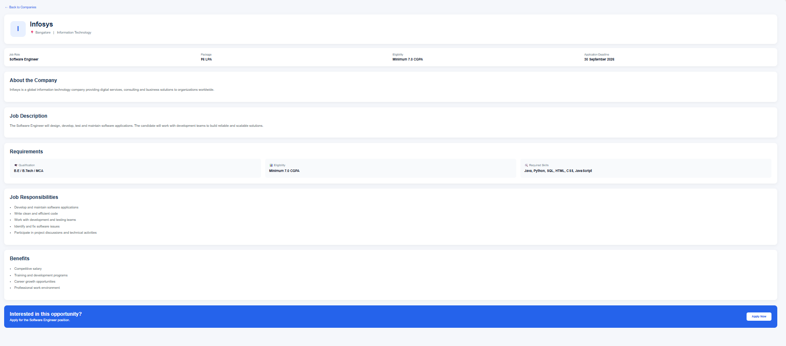
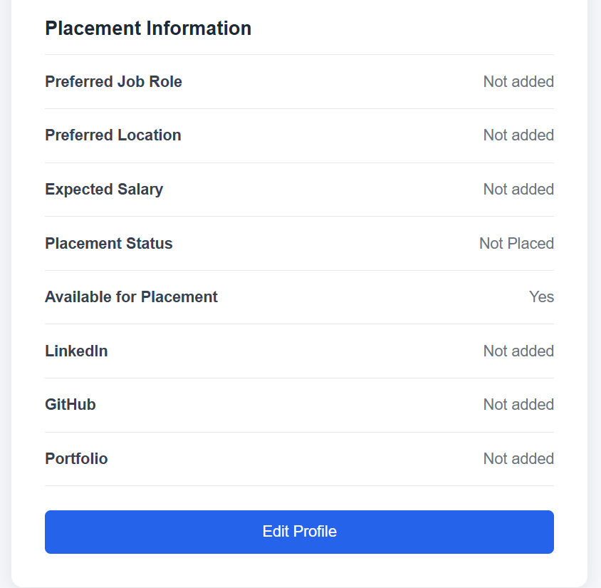
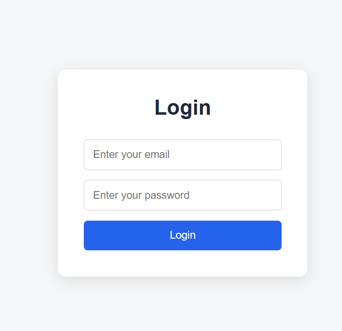
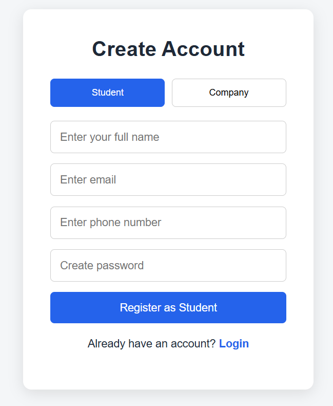

# 🎓 Placement Cell Management System

A full-stack web application designed to simplify campus recruitment by connecting students, companies, and placement administrators through a centralized platform.

## 📌 Overview

The Placement Cell Management System helps organize the campus placement process in one place. Students can manage their profiles and explore job opportunities, companies can access recruitment-related functionality, and administrators can manage placement activities.

The application is built with a React frontend and a Node.js/Express backend, with MongoDB used for data storage.

## ✨ Key Features

- **User Authentication** — Registration and login functionality.
- **Role-Based Access** — Separate functionality for students, companies, and administrators.
- **Student Profile Management** — Manage student profile information.
- **Job Management** — View and manage job opportunities.
- **Job Applications** — Support the student job application process.
- **Company Management** — Provide company-related functionality for recruitment.
- **REST API** — Connect the frontend to backend services.
- **Responsive User Interface** — A web interface built with React and CSS.

*Note: The features available depend on the current implementation of the application.*

## 🛠️ Technology Stack

| Technology | Purpose |
|---|---|
| React.js | Frontend user interface |
| JavaScript | Application logic |
| HTML5 | Page structure |
| CSS3 | Styling and layout |
| Node.js | Backend JavaScript runtime |
| Express.js | Backend server and API routes |
| MongoDB | Database |
| Mongoose | MongoDB object modeling, if used by the backend |
| npm | Dependency management |
| Git and GitHub | Version control and source-code hosting |

## 📂 Project Structure

```text
placement/
├── backend/
│   ├── models/
│   │   ├── Jobs.js
│   │   └── User.js
│   ├── routes/
│   │   ├── auth.js
│   │   ├── jobRoutes.js
│   │   └── profile.js
│   ├── server.js
│   ├── package.json
│   └── .gitignore
│
├── frontend/
│   ├── public/
│   ├── src/
│   │   ├── assets/
│   │   ├── pages/
│   │   ├── App.jsx
│   │   ├── App.css
│   │   ├── index.css
│   │   └── main.jsx
│   ├── index.html
│   └── package.json
│
├── .gitignore
└── README.md
```

## ⚙️ Getting Started

Follow these steps to run the project locally.

### Prerequisites

Install the following tools before starting:

- [Node.js and npm](https://nodejs.org/)
- [MongoDB](https://www.mongodb.com/) or a MongoDB Atlas database
- [Git](https://git-scm.com/)

### 1. Clone the Repository

```bash
git clone https://github.com/Deepika-dev6/Placement-cell-Management-System.git
cd Placement-cell-Management-System
```

### 2. Configure the Backend

Open a terminal in the backend directory:

```bash
cd backend
npm install
```

Create a `.env` file in the `backend` directory and add the environment variables required by the backend.

Example format:

```env
PORT=5000
MONGO_URI=your_mongodb_connection_string
JWT_SECRET=your_secret_key
```

Replace the example values with your actual configuration. The variable names must match those referenced in your backend code. Add any other variables your application requires.

**Security:** Never commit your real `.env` file, database credentials, tokens, or secret keys to GitHub.

Start the backend using the command configured in `backend/package.json`. For example, if the project has a `start` script:

```bash
npm start
```

### 3. Configure the Frontend

Open a second terminal from the project root:

```bash
cd frontend
npm install
```

Start the frontend using the script defined in `frontend/package.json`. For a Vite application, the usual development command is:

```bash
npm run dev
```

Open the local URL printed in the terminal, commonly `http://localhost:5173` for Vite.

### 4. Verify the Application

- Confirm that the backend starts without errors.
- Confirm that the frontend opens in your browser.
- Verify that the frontend API configuration points to your running backend.
- Confirm that MongoDB is connected and the required application features work.

## 🔐 Environment Configuration

Environment files are excluded from version control to reduce the risk of exposing sensitive information.

For local setup, create your own `.env` file using the variable names required by the source code. Never publish actual credentials in documentation or source files.

## 🎯 Project Objective

The objective of this project is to provide a centralized platform for campus recruitment, reduce manual placement-related work, and make job opportunities and recruitment information easier to manage.

## 🚀 Future Enhancements

Potential improvements include:

- Placement statistics and analytics dashboards
- Email notifications for important application updates
- Application status tracking
- Advanced job search and filtering
- Deployment with separate frontend and backend hosting

These are possible future enhancements and should not be considered implemented unless they are available in the application.

## 👩‍💻 Author

**Deepika R**

GitHub: [Deepika-dev6](https://github.com/Deepika-dev6)

## 📄 License

No license has been specified yet. Please add a license file if you intend to distribute the project under an open-source license.

## 📸 Screenshots

### 1. Student Dashboard


### 2. Student Profile


### 3. Academic Profile


### 4. Company Dashboard


### 5. Company Board


### 6. Jobs Board


### 7. Job Role Board


### 8. Personal Information Page


### 9. Login Page


### 10. Registration Page

